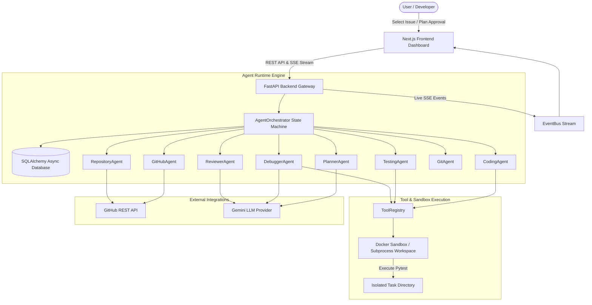

# DevAgent — Autonomous AI Software Engineer

> An autonomous AI agent platform that takes GitHub issues, understands repository context, builds implementation plans, modifies source code inside isolated sandboxes, executes tests, debugs failures iteratively, performs code reviews, commits changes, creates Pull Requests, and verifies CI workflows.

---

## Architecture Overview



---

## Core Features

- **Stateful Agent Orchestrator**: Explicit finite-state machine (`AgentOrchestrator`) managing task transitions across 16 states.
- **8 Specialized Agents**: `PlannerAgent`, `RepositoryAgent`, `CodingAgent`, `TestingAgent`, `DebuggerAgent`, `ReviewerAgent`, `GitAgent`, `GitHubAgent`.
- **Formal Tool Registry**: 18 registered tools (`list_files`, `read_file`, `search_code`, `apply_patch`, `run_tests`, `git_commit`, `create_pull_request`, etc.).
- **Docker Sandbox Execution**: Isolated Docker container execution with memory caps, CPU caps, command timeouts, path traversal guards, and local subprocess fallback.
- **Iterative Debugging Loop**: Up to 5 automated iterations of code modification -> test -> failure analysis -> fix generation -> re-test -> review.
- **Human Approval Checkpoints**: Plan review modal, stop agent capability, and human review continuation.
- **Real-Time SSE Event Stream**: Live streaming terminal logs, test outputs, agent reasoning, and interactive timeline.
- **Monaco Code Diff Viewer**: Syntax-highlighted side-by-side or unified code diff display.
- **GitHub Integration**: Automatic branch creation (`agent/issue-{id}-...`), structured commits (`feat(agent): resolve issue #{id}`), PR generation, and CI status verification.

---

## Technology Stack

- **Frontend**: Next.js 16 (App Router), TypeScript, Tailwind CSS, Monaco Editor, Lucide Icons, EventSource (SSE).
- **Backend**: Python 3.11+, FastAPI, Pydantic v2, SQLAlchemy 2 (Async), SQLite / PostgreSQL.
- **Sandbox**: Docker containerization (`python:3.11-slim`), subprocess isolation, environment sanitization.
- **Integrations**: GitHub REST API, Google Gemini LLM API (Structured Outputs).

---

## Quick Setup & Running Locally

### Option A: Local Python & Node Execution (Recommended for Fast Local Development)

1. **Install Backend Dependencies**:
   ```bash
   pip install -r backend/requirements.txt
   ```

2. **Install Frontend Dependencies**:
   ```bash
   cd frontend
   npm install
   cd ..
   ```

3. **Configure Environment Variables**:
   Copy `.env.example` to `.env`:
   ```bash
   cp .env.example .env
   ```

4. **Launch DevAgent**:
   ```bash
   python run_dev.py
   ```
   - **Frontend**: `http://localhost:3000`
   - **Backend API**: `http://localhost:8000`

---

### Option B: Docker Compose Setup

Run the full application stack (PostgreSQL, Redis, Backend, Frontend) with Docker Compose:

```bash
docker-compose up --build
```

---

## Running Automated Test Suite

Run backend end-to-end and unit tests:

```bash
PYTHONPATH=backend pytest backend/tests/ -v
```

---

## Detailed Documentation

- [Architecture Guide](docs/ARCHITECTURE.md)
- [Agents Reference](docs/AGENTS.md)
- [Tools Specification](docs/TOOLS.md)
- [Security Model](docs/SECURITY.md)
- [Demo Walkthrough](docs/DEMO.md)
